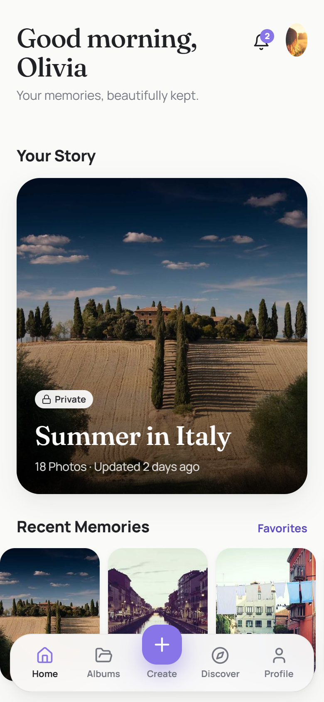

# LUMEN — Your Memories. Your Collection.

An interactive, client-ready demo of a privacy-first photo album app with NFT-linked albums.



## What this is

- A **mobile-first web app** (React + TypeScript + Vite). On a desktop it shows inside a phone frame with a guided tour beside it. On a phone it runs full-screen.
- **Every button works.** Data is saved in the visitor's browser: albums and settings in `localStorage`, uploaded photos in IndexedDB. The demo runs entirely on Vercel's static hosting, with no backend to provision.
- A **local demo backend** (`src/backend/api.ts`) enforces the same rules the production Supabase backend would. It handles sessions, ownership checks, privacy, share-link tokens with expiry, passcode and revocation, and NFT access grants. The UI never decides access on its own.
- **NFTs and the wallet are simulated** and clearly labelled "Demo Collectible", "Demo Wallet Mode" and "Demo Verification". No real blockchain assets, transactions or fees are involved.

> **Note on the stack.** The brief targets Flutter. This demo is built as a web app so it can be hosted on Vercel and opened from a link on any device. The data model, access rules and NFT adapter are written to move directly into the Flutter + Supabase build (see `supabase/`).

## Run locally

```bash
npm install
npm run dev        # http://localhost:5173
npm test           # 29 backend tests (auth, albums, upload, privacy, sharing, NFT gating, wallet)
npm run build      # production build in dist/
```

## Deploy to Vercel

**Option A: Vercel CLI**

```bash
npm i -g vercel
vercel            # first time: accept the detected Vite settings
vercel --prod
```

**Option B: GitHub**

Push this folder to a GitHub repository. Then in Vercel choose **Add New → Project → Import** and select the repository. Vercel detects Vite automatically (build: `npm run build`, output: `dist`).

`vercel.json` already rewrites every route to `index.html`, so deep links work (for example `/album/a-italy` or shared links `/s/<token>`). No environment variables are needed for the demo.

## Client walkthrough (about 5 minutes)

1. **Explore Demo**. Signs in as Olivia Parker: 6 albums, 42 photos, 2 NFT-linked albums.
2. Open **Summer in Italy**. Browse the grid, open a photo, swipe, pinch or double-tap to zoom, and open **Details**.
3. **Create** (centre tab) → **New Album**. Pick a theme; the preview updates live.
4. **Add Photos**. Pick real photos from the device or camera, add captions, watch the progress bar, then view them in the album.
5. In the photo viewer, **⋯ → Set as album cover**.
6. **Change** the privacy setting from the album page.
7. **Share → Create view-only link → Preview as recipient** shows the album as the recipient sees it.
8. Back in **Share**, choose **Revoke**, then **Test link**. The link shows "Link revoked".
9. **Profile → My Collectibles → Digital Bloom #027 → Link to Album**. The album now shows the collectible badge.
10. Open **Nocturne Members Room** from **Shared With Me** or the notifications. The album is locked. Choose **Unlock Album → Verify ownership**. Try the demo scenarios (Token not owned, Wrong network, Service down) to see each denial state.
11. Download an original photo from the viewer, then return Home.

Extras:
- **Settings**: Dark mode, reduced motion, upload quality, and *Simulate network failure* (to show retry).
- **Privacy Center**: every album's audience, active links, invitations, ZIP export of your photos, and account deletion.
- **Reset demo data**: in Settings, or in the desktop side panel.

## Project structure

```
src/
  backend/        demo backend: types, seed data, store, api (access rules), nft adapters, tests
  screens/        Onboarding, Auth, Home, Albums, AlbumForm, Upload, AlbumDetail, Viewer, Organize,
                  Share, SharedLink, Gate (NFT unlock), Collectibles, Wallet, Discover, Profile,
                  Settings, Privacy, Misc (Notifications, Favorites, Shared With Me)
  ui/             design-system components, album cards, masonry grid, privacy and theme metadata
supabase/
  migrations/0001_init.sql                 production schema, RLS policies, private storage bucket
  functions/request-gated-access/index.ts  server-side ERC-721 / ERC-1155 ownership check plus a short-lived grant
public/photos/    bundled sample photography (full size + thumbnails), so the demo works offline
docs/screenshots/ main screens
```

## Known limitations of this demo

- **Single-device data.** Everything lives in one browser. Another visitor, or another device, gets a fresh copy of the demo. "Preview as recipient" simulates the recipient on the same device.
- **Static sample photos.** Seed photos are public static files, which is fine for sample content. User uploads are stored privately in IndexedDB and are only shown after the access check. Production uses a private Supabase bucket with signed URLs (see the migration).
- **Simulated Web3.** Wallet connection and ownership checks are simulated. `EvmVerifier` (real `ownerOf` / `balanceOf` over JSON-RPC) and the Edge Function are included but not connected to a live chain in this demo.
- **HEIC.** HEIC previews depend on the browser; Safari can render them, most other browsers can't. Unsupported files show a clear error.
- **Not native.** This is not a Flutter or native build, and nothing has been published to the App Store or Google Play.

## Next phase

1. Flutter app (Riverpod, GoRouter, `image_picker`/`photo_manager`, `cached_network_image`), reusing this data model and screen flow.
2. Supabase project: apply `supabase/migrations`, plus Edge Functions for `open-share-link`, `photo-url` (signed URLs) and `request-gated-access`.
3. Server-side thumbnail generation, EXIF stripping and orphaned-upload cleanup.
4. Real wallet connection via Reown AppKit / WalletConnect, with SIWE nonce verification and Sepolia testnet collections.
5. Push notifications, contributor uploads, and comments.

Sample photography: Unsplash contributors via Lorem Picsum (free to use).
